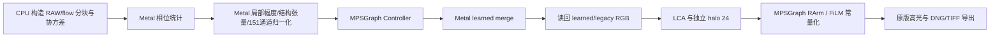

# Apple Silicon 第二轮优化

2026-10-04，M2 Pro（16 GPU 核心、32 GiB）、macOS 27.2、arm64 Python 3.10。14 张 Nikon Z6 III HE* NEF，输入 6064 × 4040，输出 12128 × 8080 RGB16。默认 v9.8 Apple 路径采用 FP32 原生 Metal 前段与 MPSGraph 网络。

## 实测结果

| 配置 | 配准缓存 | 产品处理与导出 | 纯重建 | 融合总计 | 精修总计 |
| --- | --- | ---: | ---: | ---: | ---: |
| 本轮原始 Apple 基线，384 分块 | 已准备 | 386.4 s | 323.9 s | 133.3 s | 185.9 s |
| Controller 缓存容量 3 | 已准备 | 411.0 s | 346.8 s | 148.3 s | 193.1 s |
| 独立 halo 24 + FiLM 常量化 | 已准备 | 308.6 s | 256.7 s | 117.0 s | 136.8 s |
| 原生 GPU 前段 + halo 24 + FiLM 常量化 | 从 RAW 解码及配准开始 | 246.0 s | 193.1 s | 41.7 s | 147.4 s |

最终冷启动进程总耗时为 **249.4 秒**，涵盖 Python 启动、RAW 解码、配准、重建、DNG/TIFF 导出及方向标签写入。上一轮相同 384 分块冷启动为 409.4 秒，本轮缩短 **39.1%**。表内产品计时起点来自原版入口，进程总计起点来自外层验证脚本。

全部 293,982,720 个颜色样本逐像素比较，以 `BENCHMARK.json` 的完整尺寸和指标为准。最终最大差异为 **1 DN**，RMSE **0.007374 DN**，**99.99456%** 样本与原始 WGPU 相同。暗部 RMSE 0.005965 DN，拼接边界 RMSE 0.007124 DN，三个通道分别检查通过。Orientation、BlackLevel、WhiteLevel、ColorMatrix1、AsShotNeutral 和 PhotometricInterpretation 相同。DNG 经 TIFF 解码器和 LibRaw 读回验证通过。

最终峰值进程 RSS 为 **8.80 GiB**。原生融合单块缓冲区累计分配峰值 1.30 GiB，网络入口观测到的最大 Metal 分配为 4.45 GiB。这些统计共享统一内存，分别报告。

## 算法与资源组织



相位统计、局部特征、Controller 输入和 36 通道 qmap 使用同一 Metal 资源域。Controller 直接消费特征缓冲区，将结果写入 qmap 缓冲区。151 通道特征与 qmap 保留在 GPU。分块结束时读回两张 RGB；同一批 RAW、CFA、flow 与 shift 缓冲区在两遍融合中复用。累加缓冲区由 GPU 清零，CPU 构造的分块在两遍融合间复用。

前段各阶段和 Controller 在同一条 Metal 队列异步提交；块结束时等待与检查错误。当前调度使用一个驻留块。网络异步调用的 `seconds` 是宿主提交及图编译时间，完整执行耗时计入 `merge_total`。`native_fusion_metrics` 的上传/读回字节为接口数据量，工作空间预算为估计量。

图缓存按精确 N/H/W 形状保存 MPSGraph、Executable、输入缓冲区与 feed，并采用 LRU 淘汰。容量 3 将 Controller 编译次数从 33 次减至 9 次；本机全流程耗时更长，因此默认容量为 1，容量和预算保留为可选项。边缘块采用自身形状。

重建上下文与融合上下文独立。融合保持 48 原生像素 halo；八块 RArm 的空间半径为 17 输出像素，局部幅度 Gaussian 半径为 16 输出像素，组合半径为 33 输出像素。精修采用 24 原生像素上下文，即 48 输出像素。384 分块下，精修处理像素从 150,080,000 降为 122,654,720，减少 **18.27%**。精修保持八块网络、TTA1、原版 LCA 与中央裁切契约。

FiLM 将线性绿色引导与逐点 gamma/beta 投影合成为一个仿射卷积。K14 的绿色引导和 gamma/beta 投影权重全为零，偏置保留；编译图直接生成等价常量。原始权重文件和其校验值保留。真实 K14、合成非零投影和物理边缘分别验证。

## 数值契约

MPSGraph 保持 FP32，关闭 reduced-precision fast math。相位/learned tap 使用发布包对应的 Metal 语言版本与 preserve-invariance 编译设置；macOS 14+ 使用 MSL 3.1，macOS 13 使用 MSL 3.0。局部特征和有限值检查关闭 Metal fast math，CPU 对应除法采用精确舍入。Gaussian 保持 reflect101 边界，并匹配 OpenCV 横向与对称纵向滤波的累加顺序。

相位统计和传统融合在合成 K1/K14 测试中逐值一致。全图验收门槛为最大误差 ≤1 DN，整体、暗部、通道及拼接边界 RMSE 各 ≤0.02 DN。每次运行记录实际加载库散列；验证目录保存原生源码与构建记录快照。最终源码、库和全图测试记录的散列一致。

本轮原生前段和 FiLM 优化作用于 v9.8。Fast/Stormer 沿用现有 WGPU Metal 路径。实测设备为 M2 Pro；其他芯片的性能由同一验证脚本测量。

## 参数与复现

| 环境变量 | 默认 | 含义 |
| --- | --- | --- |
| `JSR_NATIVE_FUSION` | `1` | 原生 GPU 前段；`0` 使用 WGPU 融合 |
| `JSR_METAL_FOLD_FILM` | 通用模块可用时 `1`，其余 `0` | FiLM 仿射合并及零权重常量化 |
| `JSR_RARM_HALO` | 通用模块可用时 `24`，其余 `48` | 独立精修 halo；验证范围 17–48，默认验证值 24 |
| `JSR_CONTROLLER_CACHE` / `JSR_RARM_CACHE` | `1` | 精确形状 LRU 容量，1–16 |
| `JSR_CONTROLLER_CACHE_GIB` / `JSR_RARM_CACHE_GIB` | 自适应预算 | 工作空间估计预算 |
| `JSR_METAL_TILE` | `auto` | 256 / 384 / 512 原生像素分块 |

自动分块在可用内存 ≥32 GiB 时选择 512；物理内存 ≥24 GiB 且可用内存 ≥10 GiB 时选择 384；其余选择 256。原生前段与网络在分块运行前分别检查内存预算。

```sh
macos/.venv/bin/python -m unittest discover -s macos -p test_optimizations.py -v
# After applying the portable optimizations contribution:
macos/.venv/bin/python -m unittest discover -s Core-Only-Source-Code -p test_reconstruction_optimizations.py -v
macos/.venv/bin/python macos/check_native_fusion.py --output macos/validation/fusion-stages.json

macos/.venv/bin/python macos/run_validation.py \
  --inputs-dir /absolute/path/to/14-nef-frames \
  --output-dir /absolute/path/to/fresh-output \
  --mmap-dir /absolute/path/to/fresh-output/NEWHOMOG_cache_mmap \
  --prepare-cache --compare-to /absolute/path/to/original-wgpu.dng \
  --rarm-halo 24 --fold-film --native-fusion
```

相同配准缓存的对照运行使用已有 `--mmap-dir`，省略 `--prepare-cache`。验证脚本显式设置各优化参数，原版 Apple 基线采用 halo 48、FiLM 关闭、原生前段关闭、缓存容量 1。

实现入口为 `native/fusion.metal`、`native/fusion_bridge.inc`、`native_fusion.py`、`native/graph_bridge.mm`、`metal_graph.py`、`optimization_support.py` 与 `refine_schedule.py`。脱敏测量、精度及源码散列保存在 `BENCHMARK.json`；照片、完整产物和运行日志保持 Git 忽略。

## 贡献范围

本目录贡献 Apple Silicon 的执行器、GPU 前段、RAW 桥接与 macOS 运行环境。FiLM 的 NumPy 变换、精修 halo 的数学约束和 CPU 分块复用属于独立通用优化贡献；本后端通过 `optimization_support.py` 接入。上面的 249.4 秒冷启动和 193.1 秒重建测量包含两份贡献。通用模块缺席时采用原始 FiLM、halo 48 和原始 CPU 分块调度。

两份贡献的合并版本通过 14 张 RAW 全图复测，处理全部帧。全部 293,982,720 个 uint16 色彩样本与已有优化输出逐值一致，最大差值和 RMSE 均为 0；相机元数据一致，DNG/TIFF 与 LibRaw 读回通过。该次进程耗时 255.0 秒，纯重建 188.6 秒。独立 Apple 后端的公开核心推理和原始 FiLM/halo 48 入口配置验证通过。记录见 `BENCHMARK.json` 的 `split_module_integration_validation`。
